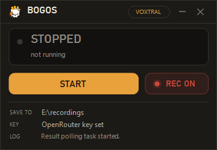

# BOGOS-bot

A Discord bot for a Warhammer 40K group. Two jobs so far: it transcribes voice channels, and it reports the matchup estimates still missing from their pairing sheet.

Fork of [Leehyunbin0131/Discord-Realtime-STT-Bot](https://github.com/Leehyunbin0131/Discord-Realtime-STT-Bot).

## Commands

| Command | What it does |
|---|---|
| `!transcript [pairing sheet link]` | Joins your voice channel and starts listening. With a link, it reads the teams, players and armies out of the sheet first and teaches them to the transcriber |
| `!stop` | Finishes the queued speech and posts the session as a clean copy plus the turns it set aside |
| `!pairing <sheets link>` | Reports whose matchup estimates are still incomplete, per team tab, and teaches the transcriber the same names |

## How transcription works

Not real time, and not per utterance. Silero VAD cuts each speaker's speech, the
pieces accumulate in a per-speaker buffer, and the moment that buffer holds one
minute it is sent to the model in one request. A whole chunk gives the model the
context that makes it spell the group's proper nouns the way the table did; a
sentence at a time it guesses, which is what "battle shop" was.

Chunks are kept per speaker, because concatenating two people into one stream
would read as dialogue but lose who said what, and a transcript without names is
not worth much in a Discord log.

Each chunk is written to the channel file as it lands, so a two-hour session is
settled as it runs rather than in one wait at the end. At `!stop` the audio
queue is drained, the buffer is flushed, and the tail is posted with the rest.

A chunk is one turn of one speaker. The buffer closes when someone else speaks,
so everything in a chunk was said in one stretch, its time is the time its first
utterance arrived, and every line prints that time. The session is sorted by it
before the file is written and the channel is posted to.

Holding the buffer open across an answer gives the model more context and leaves
no way to say which part of the reading came before the answer. Measured on the
22:51 session, a 47 second buffer of one speaker came back as five blocks placed
by proportion, and sentences landed on the wrong side of someone else's turn. A
turn-sized chunk needs no such guess. The cost is more requests: on a four
speaker meeting the median chunk goes from 27 seconds to 9, and there are about
1.6 times as many of them.

The hard ceiling is the provider's: a request body is capped at 20 MB and base64
inflates by a third, so 16 kHz mono tops out near 7.8 minutes. The right size is
much smaller, and that was measured, not assumed. Over the same 195-dump session
at four targets:

| target | chunks | words | words/s | $/h of speech |
|---|---|---|---|---|
| 30 s | 28 | 2,425 | 2.57 | $0.148 |
| **60 s** | **16** | **2,463** | **2.60** | $0.149 |
| 120 s | 9 | 2,490 | 2.62 | $0.145 |
| 300 s | 5 | 1,970 | 2.07 | $0.100 |

Every size left a *different* passage missing — the five-minute run dropped 359
words that all three smaller sizes recovered, and the one-minute run dropped a
34-sentence stretch the others had. That is not a size problem, it is the model
abandoning a chunk, and it is fixed below. Once it is, one minute and two are
level on content (2,463 against 2,490), so the pick goes to the smaller chunk:
a partial loss the density check cannot see is bounded by the chunk, and the
five-minute run dropped 359 words while still reading at a healthy 2.16 words a
second. Below 30 seconds the halves stop being utterances and the model starts
inventing text.

```
audio -> VAD -> per-speaker buffer -> 1-minute chunk -> model -> channel
```

A chunk also closes when the next utterance arrives more than 90 seconds after
its first. Without that, a chunk is bounded by audio accumulated, and audio is
not time: an intermittent speaker keeps the buffer open for minutes. On the 21:11
session one chunk held 17 seconds of speech spread over 482 seconds of wall
clock — three utterances said eight minutes apart, glued with 0.4 seconds of
silence and transcribed as one moment. Bounding the span took that session from
12 chunks with a 482-second worst span to 18 with an 87-second one.

The utterance that trips the check opens the next chunk rather than joining the
one it just exceeded, which is what makes the bound hold — appending it first
and flushing after would leave the very gap being excluded inside the chunk.

### What never reaches the channel

A turn needs 0.3 seconds of audio above -45 dBFS, counted in 20 ms frames on the
raw signal (`STT_VOICED_DBFS`, `STT_MIN_VOICED_SECONDS`). The average level could
not tell a sentence from a click on a hiss; this can. Measured on the 26 October
meeting (13 people, 1,222 utterances), every line of real speech cleared it and
what fell under it was room noise and clicks the model wrote down as "Thank
you.", "Merci." or a lone ".", plus other people's voices leaking out of an open
mic's speakers, transcribed again under the wrong name (37 of 38 of those
overlapped someone else talking). Dropping them also stopped that noise from
closing everybody else's turn: 458 of 1,115 turns were cut by it.

A reading that is only punctuation, or exactly a memorised "Thank you." or
"thanks", is thrown away in `stt/artifacts.py`. On that transcript 173 lines were
a lone "." and 49 were "Thank you." in a French conversation. "Merci", "Oui" and
"OK" stay, because the table says them for real.

Nothing else is thrown away. At `!stop` the session is sorted into two files, the
clean copy and every turn taken out of it (backchannels, words put on a breath,
sentences cut off before they said anything), both keeping each turn's time, so a
line that should not have gone is found in the second file at the same minute and
put back by hand. A short turn survives only if it names something the glossary
knows: "Orks." or "En disruption." in a pairing meeting is an answer, not a noise.
That rule is aggressive on purpose; a real "Oui." to a question goes to the second
file too. The raw transcript stays on disk beside the two.

### Two ways the model drops content, and what stops them

A chunk can come back as its opening sentence. The model reports
`finish_reason: "stop"` after six completion tokens and the rest of the audio is
simply not written down. It is deterministic per input but not predictable from
the audio: the same 24 seconds of speech read back as 61 words unlevelled, 1 word
levelled, and 5 words levelled in two parts. Nothing downstream can tell a
six-word reading of five minutes from a quiet five minutes.

A chunk can also come back as a clock -- a 300-second chunk answered `00:00`
through `04:59`, one label per second, and no speech at all.

Both are caught in `stt/chunk_transcriber.py`, where the audio length is known:
a reading under 0.8 words per second, or one that is nothing but timestamps, is
re-asked once, and the better of the two answers is kept either way. On the
Gemini route the second ask is worded differently, which is what the early stop
ignores; on Voxtral there is no prompt to reword, so it is the same question
with the sampler nudged. The rate only applies above 10 seconds — a
two-second clip that says one word is a complete reading of that clip.

Re-asking the same audio usually fails, because the model stops in the same
place: a 74.5-second chunk came back as 18 words twice over. So when both
attempts are still too thin, the chunk is **split at the silence nearest its
middle and each half is asked separately**, recursively, down to 20 seconds.
That same chunk gives 157 words in halves, including the passage that was
missing. The seam can lose a word or two where the halves meet; a lost word at
a join beats a lost paragraph.

### The paragraphing is put back from the audio

The model's paragraphing is unreliable: sometimes one line per utterance,
sometimes one paragraph for a whole chunk. Nothing in the text says where the
utterances began, so it cannot be recovered by reading it.

It does not have to be. The chunker glued the utterances together with 0.4
seconds of digital silence, and those runs are still in the PCM — so
`utterance_seconds()` reads the boundaries back out of the audio the model was
given, and a wall is cut along them. Breaks land on sentence ends, chosen so the
running share of the words reaches the running share of the seconds. Nothing is
rewritten and no word moves; a chunk that came back as one slab comes back as
seven blocks where the speaker actually paused.

Asking the model instead does not work. Sending the utterances as separate audio
parts makes it emit exactly one item per part — 8 for 8, 30 for 30 — but the
short segments lose content (57 words for 50 seconds against ~150 for the same
audio in one piece). Asking for a count in the prompt is a request, not a
guarantee: 8 of 8 for one speaker, 16 of 30 for another. And asking it to label
who is speaking does not hold either: given two speakers taking turns it
returned the right alternation with the names swapped, which is worse than no
labels. That is why chunks stay per speaker and the speaker is never guessed.

## The two routes

`STT_CHUNK_PROVIDER` picks who reads a chunk, and the widget carries a badge in
its title bar that switches it.

**Voxtral Transcribe** (`mistralai/voxtral-small-transcribe-3-0`) is the one
this team settled on. It sends the audio to `/api/v1/audio/transcriptions` and
gets text back, with no prompt at all, so the vocabulary arrives as
`context_bias`. Read the twenty clips of the 21:11 session against Gemini's and
the difference is not the names, it is everything else: it punctuates, it does
not repeat a word three times, and it does not insert an `Euh` the speaker did
not say. It is billed per second of audio, about **$0.24 per hour of speech**.

**Gemini** (`google/gemini-2.5-flash`) takes the audio as a content part of a
chat request, so the prompt travels with it and the vocabulary is named in
prose. It is about **$0.16 per hour** with the glossary cached, and it is the
route used before, kept because it costs less and it is worth re-measuring.

Both routes share everything that decides whether a reading is trustworthy.
Only the request differs, so only `_ask` differs; see
[stt/chunk_transcriber.py](stt/chunk_transcriber.py).

Neither is the lite tier. Measured on two recordings of one speaker, lite lost
the content of four of six shapings of the same audio, and flash lost none.

## The glossary

The bot transcribes a French-speaking Warhammer 40,000 tournament team: they are
reviewing army lists, agreeing pairings and matchups, then organising travel,
accommodation and payment. That is dense with names that sound like ordinary
French and are spelled nothing like it — the decoder wrote *Louvre* for Drukhari
and *ecrans* for Necrons, and on a real session *l'arcon et les cobalites* for
*l'Archon et les Kabalites*.

`glossary.txt` is a plain list of the names to expect, one per line, attached to
every transcription request. Add a line whenever a session comes back with a name
spelled wrong; it is read fresh, so the next chunk picks it up without a restart.
`glossary.local.txt` is read after it and is gitignored, for what does not belong
in a public repository: your armies, your players, the venue, the gite.

It is paid on every chunk, which is what decides its size. The whole corpus from
the rules repository is 11,303 terms, about 41,900 tokens — 95% of a one-minute
chunk, and 8.6x the cost of a session. Scoping it to the three armies of one game
is about 3,000. The list that ships costs a few hundred tokens a call (452 when
it was measured), and holds the vocabulary that is the same for everybody: the
factions under both their printed and their spoken names, the rule terms, the
wargear people name out loud, and the loanwords and tools a tournament week runs
on.

That corpus is not stored here, it is rebuilt: `tools/build_glossary_corpus.py`
reads a rules-repository CSV export and writes the terms, split into what is
named at the table and what is only read on paper. It takes a second, so the
process is the artifact — see [docs/glossary-corpus.md](docs/glossary-corpus.md).

Two things a naive list gets wrong. `Agamatus` only exists inside `Agamatus
Custodians`, so a list of whole names contains no word of half of what is said.
And `Eldar` is not in the corpus at all — 11th edition renamed it `Aeldari`,
and every player still says the old one.

A third list, `glossary.session.txt`, is written by the bot itself. The pairing
sheet is a format and a new one is made for every meeting, so the link is the
only place its names exist: either command that is handed one, `!pairing` or
`!transcript`, reads the team tabs, the player cells and the Faction column out
of the workbook and publishes them. `!stop` clears the file. A meeting's own
list is picked up by a later `!transcript` that gets no link, and one older than
twelve hours is dropped rather than handed to the next meeting, because a name
from the wrong tournament is the exact harm the list exists to prevent.

Set `STT_GLOSSARY_FILE` or `STT_GLOSSARY_LOCAL_FILE` to another path, or empty to turn
either off.

## Install

```bash
python -m venv .venv
.venv/bin/pip install -r requirements.txt
cp .env.example .env
```

Set `DISCORD_TOKEN` in `.env`. Turn on the Message Content intent in the Discord Developer Portal, and invite the bot with both the `bot` and `applications.commands` scopes. Without Message Content it never sees the commands.

Cloud transcription also needs `OPENROUTER_API_KEY`, from <https://openrouter.ai/keys>. On Windows the widget writes it for you: click the key line at the bottom of the panel, paste, SAVE. It rewrites that one line and leaves the rest of `.env` alone.

`.env` is gitignored, and `tests/test_no_secrets.py` fails the suite if a key ever reaches the tree - as a shape, or as a value that is on the machine running the tests.

## Run

```bash
.venv/bin/python main.py
```

On Windows use `./run.ps1`. Add `-RecordDir E:\recordings` to also save the session audio. `widget/BOGOS-widget.ps1` is the front panel: a readout of what the bot is doing, one key that starts and stops it, a REC latch that decides whether the voices are written to disk, and a key line that puts the OpenRouter key into `.env`. Minimising leaves it in the tray, where the BOGOS mark is the icon and a lamp dot on its corner is the status light. The mark is cut from the rules app's favicon by `tools/make_widget_icon.ps1`, which records the source and removes the editor's checkerboard. The panel can only show a log for bots it started itself. `tools/install_shortcut.ps1` puts a **BOGOS bot** shortcut on the desktop and in the Start menu, with the mark as its icon.



Every `!transcript` gets its own folder under the recordings root, named in local
time, so one conversation's material is in one place:

```text
E:\recordings\20261017-211109\
    session.json                          who spoke, at what rate
    332976311268147202__Ekvar.wav         one uncut WAV per speaker
    dumps\0001-u332976311268147202.wav    one per utterance, exactly as heard
```

The widget's REC latch decides whether any of it is written. With it off, nothing is.

## Caveats

- Do not trust a clean-speech benchmark for this job. On real French Warhammer speech, models that score well on read speech replace the proper nouns with common French words. Ours was chosen on the table, not on the benchmark.
- The silence floor (`STT_MIN_SPEECH_DBFS`) is set by eye: the 77 recorded utterances run from -96 to -40 dBFS with no gap in between, so there is nothing to tune it against. The gate that now does the work is measured instead, 0.3 s above -45 dBFS on the 26 October meeting.
- `!pairing` reads the sheet over its public link export and sends no credentials. If the sheet is private, it will not work.
- Both the session recorder and the per-utterance dumps write other people's voices to disk. The widget's REC latch turns both off and picks the folder; that latch wins over `.env`. Ask people before you turn it on.
- `CLEANUP_ENABLED` is off. A text pass cannot tell a misheard word from a real one, so it has nothing useful to do.
- Only run on Windows so far, and only against French speech.

## Tests

```bash
.venv/bin/python -m pytest -q
```

## Credits

Built on [Leehyunbin0131/Discord-Realtime-STT-Bot](https://github.com/Leehyunbin0131/Discord-Realtime-STT-Bot), which provides the process-isolated skeleton, the VAD pipeline and the resampler. This fork adds cloud STT, chunked transcription, batched output, the guard chain, the pairing reader and the recorder.

MIT. See [LICENSE](LICENSE).
