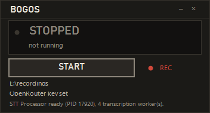

# BOGOS-bot

A Discord bot for a Warhammer 40K group. Two jobs so far: it transcribes voice channels, and it reports who has filled their pairing sheet.

Fork of [Leehyunbin0131/Discord-Realtime-STT-Bot](https://github.com/Leehyunbin0131/Discord-Realtime-STT-Bot).

## Commands

| Command | What it does |
|---|---|
| `!transcript` | Joins your voice channel and starts listening |
| `!stop` | Finishes the queued speech and posts the transcript |
| `!pairing <sheets link>` | Reports who still owes matchups or a list, per team tab |

## How transcription works

Not real time, and not per utterance. Silero VAD cuts each speaker's speech, the
pieces accumulate in a per-speaker buffer, and the moment that buffer holds one
minute it is sent to the model in one request. A whole chunk gives the model the
context that makes it spell the game's proper nouns the way the table did; a
sentence at a time it guesses, which is what "battle shop" was.

Chunks are kept per speaker, because concatenating two people into one stream
would read as dialogue but lose who said what, and a transcript without names is
not worth much in a Discord log.

Each chunk is written to the channel file as it lands, so a two-hour session is
settled as it runs rather than in one wait at the end. At `!stop` the audio
queue is drained, the buffer is flushed, and the tail is posted with the rest.

Per-speaker chunks come out in completion order, not in the order they were
spoken: the quiet player's last five minutes can be built before the talkative
one's first. Every chunk carries the time its first utterance arrived, so the
session is sorted back into that order before the file is written and the
channel is posted to.

The hard ceiling is the provider's: a request body is capped at 20 MB and base64
inflates by a third, so 16 kHz mono tops out near 7.8 minutes. The right size is
much smaller, and that was measured, not assumed. Over the same 195-dump session
at four targets:

| target | chunks | words | words/s | $/h of speech |
|---|---|---|---|---|
| 30 s | 28 | 2,425 | 2.57 | $0.148 |
| **60 s** | **16** | **2,463** | **2.60** | $0.149 |
| 120 s | 9 | 2,490 | 2.62 | $0.145 |
| 300 s | 5 | 1,970 | 2.07 | $0.100 |

Every size left a *different* passage missing — the five-minute run dropped 359
words that all three smaller sizes recovered, and the one-minute run dropped a
34-sentence stretch the others had. That is not a size problem, it is the model
abandoning a chunk, and it is fixed below. Once it is, one minute and two are
level on content (2,463 against 2,490), so the pick goes to the smaller chunk:
a partial loss the density check cannot see is bounded by the chunk, and the
five-minute run dropped 359 words while still reading at a healthy 2.16 words a
second. Below 30 seconds the halves stop being utterances and the model starts
inventing text.

```
audio -> VAD -> per-speaker buffer -> 1-minute chunk -> model -> channel
```

A chunk also closes when the next utterance arrives more than 90 seconds after
its first. Without that, a chunk is bounded by audio accumulated, and audio is
not time: an intermittent speaker keeps the buffer open for minutes. On the 21:11
session one chunk held 17 seconds of speech spread over 482 seconds of wall
clock — three utterances said eight minutes apart, glued with 0.4 seconds of
silence and transcribed as one moment. Bounding the span took that session from
12 chunks with a 482-second worst span to 18 with an 87-second one.

The utterance that trips the check opens the next chunk rather than joining the
one it just exceeded, which is what makes the bound hold — appending it first
and flushing after would leave the very gap being excluded inside the chunk.

### Two ways the model drops content, and what stops them

A chunk can come back as its opening sentence. The model reports
`finish_reason: "stop"` after six completion tokens and the rest of the audio is
simply not written down. It is deterministic per input but not predictable from
the audio: the same 24 seconds of speech read back as 61 words unlevelled, 1 word
levelled, and 5 words levelled in two parts. Nothing downstream can tell a
six-word reading of five minutes from a quiet five minutes.

A chunk can also come back as a clock -- a 300-second chunk answered `00:00`
through `04:59`, one label per second, and no speech at all.

Both are caught in `stt/gemini_transcriber.py`, where the audio length is known:
a reading under 0.8 words per second, or one that is nothing but timestamps, is
re-asked once with a prompt that names the failure, and the longer of the two
answers is kept either way. The rate only applies above 10 seconds — a
two-second clip that says one word is a complete reading of that clip.

Re-asking the same audio usually fails, because the model stops in the same
place: a 74.5-second chunk came back as 18 words twice over. So when both
attempts are still too thin, the chunk is **split at the silence nearest its
middle and each half is asked separately**, recursively, down to 20 seconds.
That same chunk gives 157 words in halves, including the passage that was
missing. The seam can lose a word or two where the halves meet; a lost word at
a join beats a lost paragraph.

### The paragraphing is put back from the audio

The model's paragraphing is unreliable: sometimes one line per utterance,
sometimes one paragraph for a whole chunk. Nothing in the text says where the
utterances began, so it cannot be recovered by reading it.

It does not have to be. The chunker glued the utterances together with 0.4
seconds of digital silence, and those runs are still in the PCM — so
`utterance_seconds()` reads the boundaries back out of the audio the model was
given, and a wall is cut along them. Breaks land on sentence ends, chosen so the
running share of the words reaches the running share of the seconds. Nothing is
rewritten and no word moves; a chunk that came back as one slab comes back as
seven blocks where the speaker actually paused.

Asking the model instead does not work. Sending the utterances as separate audio
parts makes it emit exactly one item per part — 8 for 8, 30 for 30 — but the
short segments lose content (57 words for 50 seconds against ~150 for the same
audio in one piece). Asking for a count in the prompt is a request, not a
guarantee: 8 of 8 for one speaker, 16 of 30 for another. And asking it to label
who is speaking does not hold either: given two speakers taking turns it
returned the right alternation with the names swapped, which is worse than no
labels. That is why chunks stay per speaker and the speaker is never guessed.

The model is `google/gemini-2.5-flash`, not the lite tier. Measured on two
recordings of one speaker, lite lost the content of four of six shapings of the
same audio, and flash lost none.

## Install

```bash
python -m venv .venv
.venv/bin/pip install -r requirements.txt
cp .env.example .env
```

Set `DISCORD_TOKEN` in `.env`. Turn on the Message Content intent in the Discord Developer Portal, and invite the bot with both the `bot` and `applications.commands` scopes. Without Message Content it never sees the commands.

## Run

```bash
.venv/bin/python main.py
```

On Windows use `./run.ps1`. Add `-RecordDir E:\recordings` to also save the session audio. `widget/BOGOS-widget.ps1` is the front panel: a readout of what the bot is doing, one key that starts and stops it, and a REC latch that decides whether the voices are written to disk. Minimising leaves it in the tray, where the icon doubles as the status light. It can only show a log for bots it started itself.



Every `!transcript` gets its own folder under the recordings root, named in local
time, so one conversation's material is in one place:

```text
E:\recordings\20261017-211109\
    session.json                          who spoke, at what rate
    332976311268147202__Ekvar.wav         one uncut WAV per speaker
    dumps\0001-u332976311268147202.wav    one per utterance, exactly as heard
```

The widget's REC latch decides whether any of it is written. With it off, nothing is.

## Caveats

- Do not trust a clean-speech benchmark for this job. On real French Warhammer speech, models that score well on read speech replace the proper nouns with common French words. Ours was chosen on the table, not on the benchmark.
- The silence floor (`STT_MIN_SPEECH_DBFS`) is set by eye. The 77 recorded utterances run from -96 to -40 dBFS with no gap in between, so there is nothing to tune it against yet.
- `!pairing` reads the sheet over its public link export and sends no credentials. If the sheet is private, it will not work.
- Both the session recorder and the per-utterance dumps write other people's voices to disk. The widget's REC latch turns both off and picks the folder; that latch wins over `.env`. Ask people before you turn it on.
- `CLEANUP_ENABLED` is off. A text pass cannot tell a misheard word from a real one, so it has nothing useful to do.
- Only run on Windows so far, and only against French speech.

## Tests

```bash
.venv/bin/python -m pytest -q
```

## Credits

Built on [Leehyunbin0131/Discord-Realtime-STT-Bot](https://github.com/Leehyunbin0131/Discord-Realtime-STT-Bot), which provides the process-isolated skeleton, the VAD pipeline and the resampler. This fork adds cloud STT, chunked transcription, batched output, the guard chain, the pairing reader and the recorder.

MIT. See [LICENSE](LICENSE).
